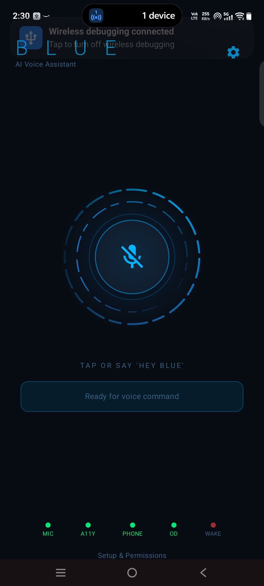
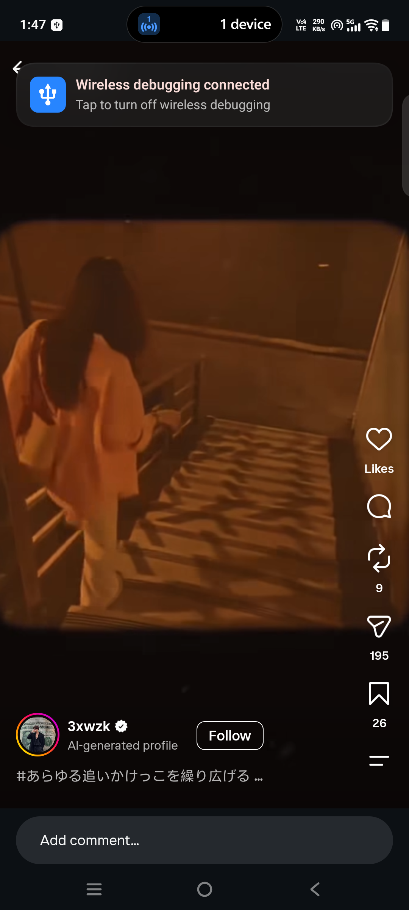
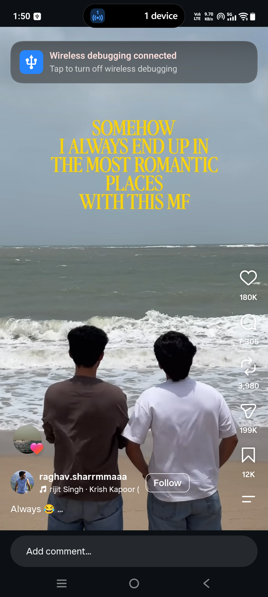
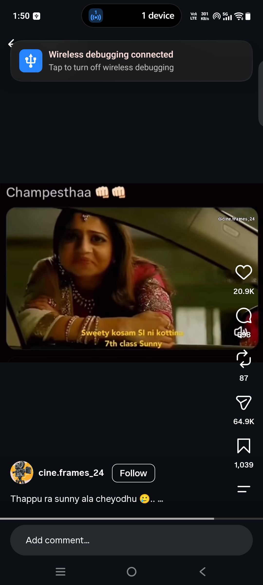
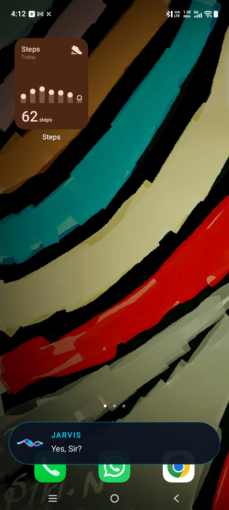
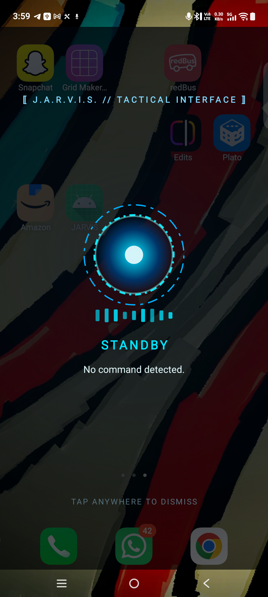
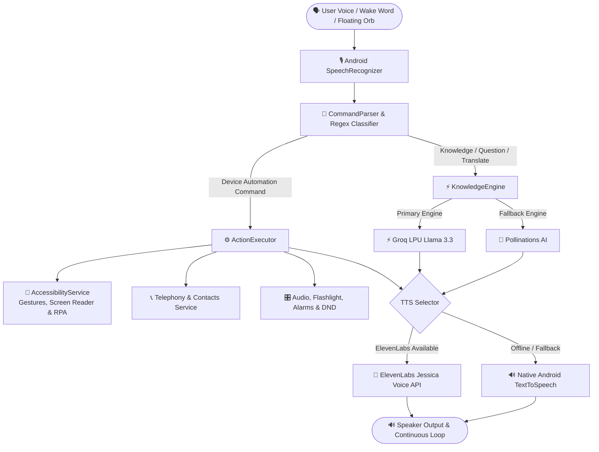

<div align="center">

# 💎 BLUE — Advanced Native Android AI Voice Assistant

<p align="center">
  <strong>The next-generation, hyper-natural AI voice companion for Android.</strong><br>
  Powered by ElevenLabs Natural Female Voice, Groq LPU AI Intelligence, Polyglot Translation (English, Telugu, Hindi, Lambadi), Universal Relationship Memory, and Deep Accessibility Automation.
</p>

[-3DDC84?style=for-the-badge&logo=android&logoColor=white)](https://developer.android.com)
[](https://kotlinlang.org)
[](https://groq.com)
[](https://elevenlabs.io)
[](https://developer.android.com/jetpack/compose)
[](https://opensource.org/licenses/MIT)

</div>

---

## 📸 Visual Showcase

<div align="center">
  <table>
    <tr>
      <td align="center" width="33%">
        <br/>
        <b>Cyberpunk Neon Voice HUD</b>
      </td>
      <td align="center" width="33%">
        <br/>
        <b>Memory & Workflow Dashboard</b>
      </td>
      <td align="center" width="33%">
        <br/>
        <b>1-Tap Permissions Setup</b>
      </td>
    </tr>
    <tr>
      <td align="center" width="33%">
        <br/>
        <b>Hands-Free Reels Navigation</b>
      </td>
      <td align="center" width="33%">
        <br/>
        <b>Dynamic Floating Pill HUD</b>
      </td>
      <td align="center" width="33%">
        <br/>
        <b>Arc Reactor System Overlay</b>
      </td>
    </tr>
  </table>
</div>

---

## 🌟 Key Highlights & Superpowers

### 🎙️ 1. Ultra-Realistic Jessica Voice (ElevenLabs)
- Expressive, sweet, natural female AI voice with human-like breathing, cadence, and warmth.
- Fully compatible with ElevenLabs free-tier endpoints (`cgSgspJ2msm6clMCkdW9`).
- High-performance local caching with seamless offline Android TTS fallback.

### ⚡ 2. Groq LPU Instant Thinking Engine
- Powered by **Llama 3.3 70B Versatile** and **Llama 3.1 8B Instant** on Groq LPUs.
- Lightning-fast response times (~300ms) with zero cloud lag.
- Resilient fallback to **Pollinations AI** (100% free, no API keys required).

### 🌐 3. Polyglot Mastery & Real-time Translation
- Native conversational support across **English**, **Telugu (తెలుగు)**, **Hindi (हिंदी)**, and **Lambadi / Gorboli (లంబాడీ / गोरबोली / Banjara)**.
- Full support for Romanized transliteration (`"kaso che"`, `"tharo naam kai che"`, `"bagunnava"`).
- Instant cross-language translation:
  - *"Translate this Lambadi to Telugu: tharo naam kai che"*
  - *"Translate hello to Lambadi"*
  - *"Isko Hindi me translate karo"*

### 🧠 4. Universal Dynamic Relationship Memory
- Speak relationships naturally:
  - *"Teja is my brother"*
  - *"Harsha JR is my Bamardhi"*
- Call or message contacts directly by relationship:
  - *"Call my brother"*
  - *"Call Bamardhi"*
- Voice & UI Memory Management:
  - Say *"Forget my Bamardhi"* or tap **Erase** in the Settings Memory Dashboard.

### 👁️ 5. Screen Intelligence ("Look at My Screen")
- Real-time active window text extraction via Android Accessibility node hierarchy (< 50ms).
- Zero screenshots taken, zero battery drain, and 100% private.
- Blue reads and explains what's on your screen:
  - *"Look at my screen and summarize this article"*
  - *"Screen choodu"* (Telugu)
  - *"Meri screen dekho"* (Hindi)

### 🔄 6. Continuous Hands-Free Voice Chat Mode
- ChatGPT Voice-style continuous conversational back-and-forth.
- Blue automatically listens again after answering without needing wake-words or button presses.
- Say *"Start chat mode"* or toggle it anytime in the Settings sheet.

### 🚀 7. Deep Accessibility Automation & Hands-Free Gestures
- **Reels & TikTok Control**: *"Next reel"*, *"Previous reel"*, *"Like reel"* without touching your phone.
- **WhatsApp Automation**: *"Send WhatsApp to Teja saying I am on my way"* with automated dispatch.
- **Phone Call Management**: Hands-free call answering, declining, and speakerphone toggles.
- **System Settings**: Flashlight/Torch, Volume 0–15, Do Not Disturb, Lock Screen, Alarms, Timers, App Launching.

### 🧩 8. Custom Multi-Step Workflows & Routines
- Chain multiple phone actions into a single custom trigger:
  - *"Run workflow night routine"* ➔ Enables DND, mutes media, turns off flashlight, locks screen.
  - *"Run workflow gaming"* ➔ Sets volume to 12, turns off torch, launches game.

---

## 🏗️ System Architecture



---

## 📂 Project Structure

```
Jarvis/
├── app-project/                         # Complete Android Studio Project
│   ├── app/
│   │   ├── src/main/java/com/example/jarvis/
│   │   │   ├── accessibility/           # Screen reader & gesture automation
│   │   │   ├── assist/                  # Power-button Default Assistant activity
│   │   │   ├── knowledge/               # Groq LPU & Pollinations AI engine
│   │   │   ├── notifications/           # Spoken notification reader service
│   │   │   ├── overlay/                 # Floating holographic HUD & pill overlay
│   │   │   ├── parser/                  # Rule & regex multilingual command parser
│   │   │   ├── repository/              # SharedPreferences relationship & workflow storage
│   │   │   ├── speech/                  # Wake-word & continuous voice listening
│   │   │   ├── telephony/               # Incoming call voice handler & fuzzy contacts
│   │   │   ├── tile/                    # Quick Settings notification shade tile
│   │   │   ├── tts/                     # ElevenLabs Jessica + Android TTS coordinator
│   │   │   └── ui/                      # Jetpack Compose dark cyberpunk theme & settings
│   │   └── src/test/                    # 24/24 unit test suite
│   ├── build.gradle.kts                 # Project Gradle configuration
│   └── settings.gradle.kts              # Modules & dependency repositories
├── assets/
│   └── screenshots/                     # UI screenshots & showcase graphics
├── docs/                                # Technical architecture documentation & PDFs
├── COMMANDS.md                          # Full voice commands cheat-sheet
├── PERMISSIONS_AND_LIMITATIONS.md       # Privacy, security & accessibility details
└── README.md                            # Main project documentation
```

---

## ⚡ Voice Commands Quick Reference

| Category | Commands |
|---|---|
| **Relationships** | `[name] is my [relation]` • `call my brother` • `call bamardhi` • `forget my bamardhi` |
| **Translation** | `translate this lambadi to telugu: [text]` • `translate [text] to hindi` |
| **Screen Vision** | `look at my screen` • `explain this screen` • `screen choodu` • `meri screen dekho` |
| **Continuous Chat** | `start chat mode` • `enable chat mode` • `stop chat mode` |
| **Workflows** | `run workflow [name]` • `create workflow [name] steps [action 1] and then [action 2]` |
| **Social / Reels** | `next reel` • `previous reel` • `like reel` • `scroll down` • `scroll up` |
| **Calls & WhatsApp**| `call [name]` • `call [name] on speaker` • `send whatsapp to [name] saying [message]` |
| **Incoming Calls** | `accept` / `answer` • `decline` / `reject` • `silent` |
| **Hindi (हिंदी)** | `torch on karo` • `battery kitni hai` • `samay kya hai` • `agli reel` • `[naam] ko phone lagao` |
| **Lambadi (गोरबोली)**| `Ram Ram Blue` • `tharo naam kai che` • `kaso che` • `light laga` • `[naam] ne phone laga` |

👉 *For the comprehensive list of 100+ commands, see [COMMANDS.md](COMMANDS.md).*

---

## 🛠️ Build & Installation

### Requirements
- **Android Studio** Ladybug / Hedgehog or newer
- **JDK 17** (bundled with Android Studio)
- **Android SDK** API 26+ (Target: Android 14 / API 34)
- **Target Device**: Any modern Android smartphone (optimized for Snapdragon 8 Gen 3 / iQOO 12)

### 1. Clone the Repository
```bash
git clone https://github.com/SarathChandra26/Blue-AI-Assistant.git
cd Blue-AI-Assistant/app-project
```

### 2. Build Debug APK
```bash
# On Windows
.\gradlew.bat assembleDebug

# On macOS / Linux
./gradlew assembleDebug
```
The compiled APK will be located at:
`app-project/app/build/outputs/apk/debug/app-debug.apk`

### 3. Install via Wireless ADB
```bash
adb connect <PHONE_IP>:<PORT>
adb install -r app/build/outputs/apk/debug/app-debug.apk
```

---

## 🔒 Privacy & Permissions Architecture

Blue is engineered with a **privacy-first, on-device priority**:
- **Accessibility Service**: Used exclusively for UI gestures (swiping reels, clicking send on WhatsApp) and reading visible text nodes on request. No screen recordings, passwords, or personal data are ever tracked or stored.
- **Audio & Microphone**: Audio is processed in real time and discarded immediately after transcription.
- **Local Storage**: All relationship memories and custom workflows are stored strictly on-device in private encrypted SharedPreferences.
- **Zero Mandatory Costs**: Operates completely free using on-device engines with optional free cloud enhancements (Groq & Pollinations).

See [PERMISSIONS_AND_LIMITATIONS.md](PERMISSIONS_AND_LIMITATIONS.md) for full audit disclosures.

---

## 🗺️ Roadmap: The Evolution of Blue

- [x] **v1.0**: Native offline Android voice control (Apps, Settings, Flashlight, Volume, DND).
- [x] **v2.0**: Floating Assistive Orb, Siri-like dynamic pill HUD, and incoming call voice controls.
- [x] **v3.0**: Instagram Reels hands-free gesture swiping & Notification Reader.
- [x] **v4.0**: Rebranding to **Blue**, ElevenLabs Jessica multilingual voice integration, and Groq LPU engine.
- [x] **v5.0**: Universal Relationship Memory, Polyglot Live Translation (Lambadi / Telugu / Hindi / English), Continuous Chat Mode, Screen Vision, and Custom Multi-Step Workflows.
- [ ] **v6.0 (Upcoming)**:
  - 👁️ **Blue Vision**: Real-time Camera Eyes (multimodal live visual Q&A).
  - ⚡ **Full-Duplex Voice**: Interruptible real-time audio streaming (Gemini Live / GPT-4o style).
  - 🤖 **Autonomous App Agent**: Multi-step deep app execution across Swiggy, Uber, YouTube.
  - 📞 **Blue Secretary**: Autonomous AI call screening & live conversational voicemail.
  - 🧠 **100% Offline Edge Brain**: On-device Gemma 2B / SmolLM running locally on Snapdragon NPU.

---

## 👨‍💻 Author & Credits

Crafted with ❤️ by **[Sarath Chandra](https://github.com/SarathChandra26)**.

- **GitHub**: [@SarathChandra26](https://github.com/SarathChandra26)
- **LinkedIn**: [Sarath Chandra](https://www.linkedin.com/in/sarathchandra26)

---

## 📄 License

This project is licensed under the [MIT License](LICENSE).
